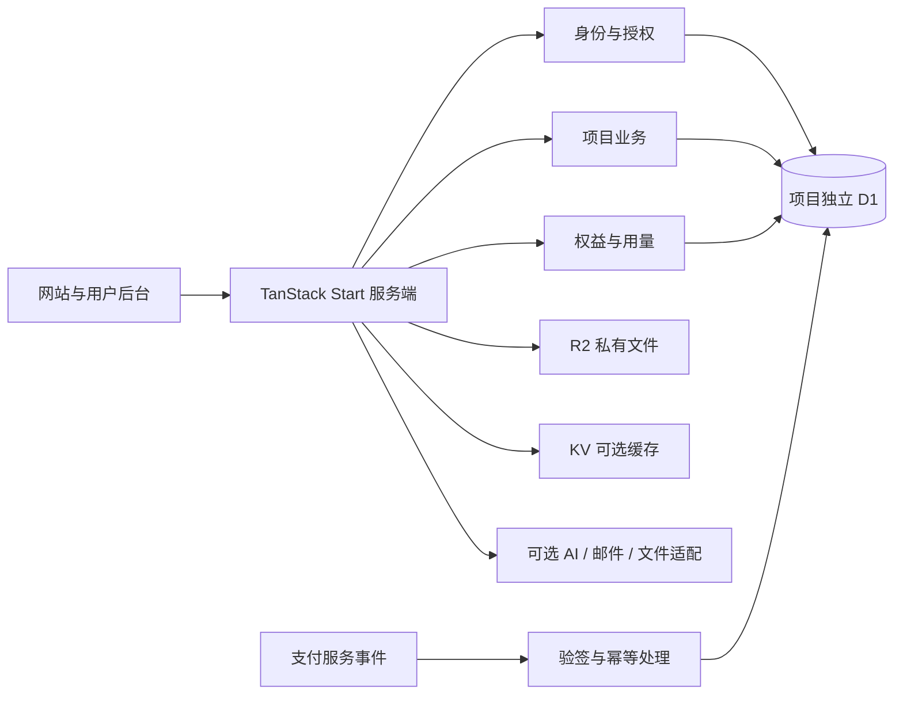

# 开源产品底座实施方案

调研日期：2026-10-21（Asia/Shanghai）。状态：方案保留为设计记录；v0.1 本地首版已实现，实际交付与未接入能力以 [README](../README.md) 和 [验收记录](../qa/acceptance.md) 为准。下文后续阶段不代表已实现。

## 1. 建议结论

做一套自己持续使用的开源产品底座，优先服务新的独立 Web / AI 工具。首版采用 **TanStack Start + TanStack Router + React + TypeScript + Vite + pnpm + Tailwind CSS + shadcn/ui + Better Auth + Drizzle + Cloudflare D1**，运行在 **Cloudflare Workers**，文件存储使用 **R2**，KV 按需用于非强一致缓存；TanStack Query 按实际服务端状态管理需要接入。

已确定的选择（2026-10-21）：用户选择 TanStack，并进一步选择 Cloudflare 全栈。当前默认架构为 Workers / D1 / R2；前版 PostgreSQL + Node/Docker 建议不再是首版交付目标。详细服务边界与额度见 [Cloudflare 方案](CLOUDFLARE.md)。

定位是“基础功能经过验证、便于 AI 理解、能持续获得修复的产品起点”。开源、AI 规则文件和基础登录支付已经是现有竞品能力，不能单独作为差异化。我们先用自身项目证明启动速度、修改成本和升级效果，再据此形成公开案例。

已确认的产品方向（2026-10-22）：**海外 Web / AI 工具优先，兼顾国内**，保留中文开发体验与中英界面。部署优先验证 Cloudflare，支付优先打通 Stripe 测试订阅；这不代表已拥有供应商账户或具备正式收款资格。国内访问体验、登录与支付接入按具体产品需求单独验证，不在首版并行维护另一套部署栈。已有项目默认不强制迁移；小程序和原生桌面/移动端保持原有技术栈，未来按需要复用 API 和业务规则。

## 2. 为什么值得维护自己的版本

- 一套熟悉的项目结构、配置和服务接口，减少每次让 AI 重新发明基础设施。
- 支付、用户隔离、文件权限、额度并发都有明确的数据约束和行为测试。
- 外部服务可选。未配置支付、AI、云存储时，核心项目仍能启动和构建。
- 新项目互相独立，每个项目使用自己的部署、数据库和密钥；共享代码不等于共享用户数据或订阅。
- 公开代码、中文文档、可复现示例和变更记录一起维护。

开源软件许可免费不代表主机、数据库、邮件、模型调用、存储或支付处理免费。首版不承诺固定月成本或无条件免费上线。

## 3. 技术选型与替代路线

| 层             | 首选                                                             | 理由与限制                                                                                    |
| -------------- | ---------------------------------------------------------------- | --------------------------------------------------------------------------------------------- |
| 应用           | TanStack Start + React + TypeScript                              | SSR、类型化路由、loader 与 server functions 组织应用；明确服务端/浏览器代码边界               |
| 构建与数据获取 | Vite + TanStack Router；Query 按需接入                           | 路由、参数与数据加载保持一致；避免同一数据同时维护两套缓存                                    |
| 工具           | pnpm，ESLint，TypeScript，Prettier                               | 单一包管理器，锁定依赖与运行时版本；不依赖全局 latest 保持可复现                              |
| 界面           | Tailwind CSS + shadcn/ui                                         | 少量必要组件，统一主题；不用大量动画模块充数量                                                |
| 身份           | Better Auth，服务端会话                                          | 使用现有认证实现；首版不自写密码学、JWT 签发框架或 OAuth 协议                                 |
| 数据           | Cloudflare D1 + Drizzle 的 SQLite/D1 方言                        | 用户、会话、订单、权益、额度流水存 D1；依照 D1 原子更新、唯一约束和 batch 设计一致性          |
| 邮件           | Cloudflare Email Service（账户/域名可用时）；HTTP 发信适配可替换 | 本地使用测试收件箱；CF 向任意用户发信需要 Workers Paid，不能把 Email Routing 免费转发当成发信 |
| 支付           | Stripe 测试模式作为首个参考适配器                                | 使用 provider 事件维护本地权益；正式收款另验账户资格和真实流程                                |
| AI             | Workers AI 优先评估，AI SDK 作为可选应用接口                     | 一个流式文本示例；外部模型另计费，CF 免费神经元不等于外部模型免费                             |
| 文件           | Cloudflare R2 binding                                            | 私有 bucket、元数据/权限在 D1，后续按需要提供直传；不把所有对象公开                           |
| 缓存           | KV / Cache API 按需使用                                          | 公开或可容忍陈旧的结果；不存储扣费权威状态或幂等锁                                            |
| 测试           | Vitest + Playwright + 本地 D1/R2 集成测试                        | Cloudflare 本地运行时验证业务行为，并在预发布验证远端 bindings                                |
| 部署           | Cloudflare Vite plugin + Workers / Wrangler                      | 固定兼容日期与类型生成；Node 仅为本地构建工具，首版不交付 Node 服务部署                       |

[TanStack 官方部署文档](https://tanstack.com/start/latest/docs/framework/react/guide/hosting)同时说明 Node（Nitro）和 Cloudflare 等运行路线；[认证文档](https://tanstack.com/start/latest/docs/framework/react/guide/authentication)说明身份由应用/认证库提供，服务端数据边界必须授权；[Better Auth](https://better-auth.com/docs/adapters/drizzle)提供 Drizzle 适配；[AI SDK](https://ai-sdk.dev/docs/introduction)提供跨模型接口。这些是选型依据，不是本方案已集成成功的证据。

**选择 TanStack 的原因。** 类型化路由、搜索参数和 server functions 适合强调交互的工具与用户后台；Vite 和明确的应用数据流也便于建立自己的开发约定。这是针对本项目的架构判断，不等于 Next.js 不适合 SaaS，也不意味着 AI 生成代码天然安全。前版以 Next.js 通用偏好压过项目具体目标的权重过高。

**Cloudflare 已作为默认路线。** TanStack Start 使用官方 Cloudflare Vite 插件路径。当前没有应用代码或既有数据库，因此直接以 D1 schema 和迁移开始，不需要做 PostgreSQL 数据迁移。以后若支持 PostgreSQL，则另做方言、驱动、迁移和一致性验收，不能靠改连接字符串承诺兼容。[Cloudflare 官方指南](https://developers.cloudflare.com/workers/framework-guides/web-apps/tanstack-start/)

**代价。** 需要验证 Start、Cloudflare 插件、Better Auth / D1 及发信的固定版本组合；不引入依赖常驻 Node 进程、本地文件或原生扩展的生产模块。首版先评估免费计划，但不为了卡住免费额度削弱密码安全或订单一致性；正式邮箱注册和较重 SSR 应准备 Workers Paid 的账户级月费与实际用量预算。

具体框架与 SDK 版本在实现时核对稳定版本、安全公告和适配组合，随后固定到 lockfile；不照搬竞品 README 中互相矛盾的版本号。

## 4. 代码如何整合

从官方框架脚手架开始，直接集成成熟开源组件，编写我们自己的业务连接代码。首版不完整 fork 一个功能庞大的竞品，也不拼接多个完整模板。

| 参考来源                    | 借鉴内容                                                          | 不直接继承的负担                                                                                        |
| --------------------------- | ----------------------------------------------------------------- | ------------------------------------------------------------------------------------------------------- |
| oakoss/open-saas-kit（MIT） | TanStack Start、Better Auth、Drizzle、PostgreSQL 的组织与集成方式 | 本轮未运行；不因 README 的 fully featured 表述推定支付等全链路可用；不必继承 Turborepo 或 React Aria UI |
| Next.js SaaS Starter（MIT） | 简明的路由、账单、团队与活动日志示例                              | 不原样继承示例认证和旧依赖；仓库自称学习资源                                                            |
| Open SaaS（MIT）            | 本地运行、后台任务、支付和 E2E 的完整交付思路                     | 不引入 Wasp/Prisma 第二套框架和 ORM                                                                     |
| Makerkit Lite（MIT）        | 目录约束、UI、一致的开发体验                                      | 不同时引入 Supabase Auth 与 Better Auth；不把商业版功能当作 Lite 源码                                   |
| Saasfly（MIT）              | 中文文档和提供商整合思路                                          | 不原样继承 Bun、Clerk 和较旧依赖组合                                                                    |
| 商业模板                    | 公开功能范围与用户体验对标                                        | 不导入其源码、设计资产或专有文案                                                                        |

实际复制任何开源代码前，记录来源 URL、固定 commit、路径、许可证与修改；保留原始版权和许可。依赖采用包管理器引用，不通过改名掩盖来源。若参考后完全独立实现，也明确区分“设计参考”和“代码采用”。

建议未来应用采用 MIT，以便他人商用、修改和闭源衍生，同时保留必需的上游通知；不额外添加“禁止商用”等与此目标冲突的限制。公开前核对完整依赖和资产许可证，不能用仓库顶层 MIT 代替所有第三方检查。

## 5. 首版结构

前端同时遵循[前端约定](FRONTEND.md)：统一 shadcn 风格与主题、Lucide 图标，按需加入 Motion、拖动面板和拖拽能力，明确 Router / Query / 本地状态的归属。库清单不等于首版全部安装；规则将与页面样板、未来 AGENTS.md 和检查入口一起交付。

先使用单应用仓库；尚无第二个真实消费者时，不引入 Turborepo、微服务或通用插件市场。

```text
src/
  routes/               # 文件路由、页面、loader 与 HTTP 入口
  router.tsx            # 路由与应用上下文
  server/               # server functions、鉴权中间件与服务端入口
  components/           # UI 与布局
  config/               # 品牌、功能、服务端环境配置
  modules/
    auth/               # 用户、会话、服务端身份检查
    billing/            # 订单、事件、订阅、Stripe 适配器
    entitlements/       # 业务权限与套餐能力
    usage/              # 用量及额度流水（AI 版本启用）
    ai/                 # 模型调用、流式响应、错误处理
    files/              # 文件元数据与权限
    mail/               # 邮件模板与传输
    projects/           # 用于验证用户隔离的示例业务
  db/                   # D1 schema、迁移与 binding 访问
tests/                  # 单元、集成、浏览器验收
docs/                   # 安装、架构、部署、迁移、故障处理
scripts/                # 环境诊断与初始化
```

模块边界按真实变化点划分。先为选定的服务实现功能；出现第二个实际提供商时再完善适配接口，避免预先建一个无人使用的通用抽象层。



Server functions 可服务同一 Web 应用；需要被小程序或原生应用调用的能力，应另建经过鉴权的 HTTP API。不会把框架内部调用协议当作跨端 API，也不会默认给不同产品合并账号。路由 beforeLoad 可改善访问体验，但每个私有 server function / server route 仍须在服务端做身份、资源归属与权限检查。

## 6. 分阶段交付

### v0.1：可作为真实项目起点

交付：品牌配置、简洁首页、定价展示、中文/英文基础文案、明暗主题、登录注册/验证/重置密码、个人设置、用户隔离的示例 CRUD、管理员基础页面、邮件、Stripe 测试模式订单与订阅、服务端权益判断、D1 迁移、Cloudflare 本地运行与预发布配置、CI、中文快速开始和 AGENTS.md。

默认关闭真实支付；无支付、OAuth、AI、云存储凭证时仍可开发核心流程。邮件使用本地测试服务；生产配置缺失时给出清楚错误。不能通过假成功状态掩盖未接通的集成。

首版只支持个人账户的业务数据范围，管理员是平台角色。组织、邀请、团队席位计费和多租户成员关系属于后续范围，不提前引入团队抽象。

### v0.2：AI 工具闭环

交付：一个可用的流式 AI 文本工具、历史记录、用量记录、并发安全的额度预留/结算/释放、文件上传/私有读取/删除、套餐配额，以及第一个真实 Web/AI 产品的接入记录。

额度规则明确区分供应商实际已计费和用户业务是否完成。断流、取消、超时、重试不能笼统全部退款，也不能重复扣除；先定义结算策略再实现。

### v0.3：跨项目复用得到验证后

第二个独立项目接入；总结迁移成本后再考虑初始化 CLI、共享包、第二种支付适配器、组织团队和后台任务。需要可靠异步任务时评估 Queues / Workflows，需要实时协调时评估 Durable Objects；不为了“全栈”首版全部引入。其他部署平台与数据库暂不作为维护目标。

首版延期：多框架同时维护、统一多产品账户/订阅中心、微信支付与小程序支付、Apple/Android 内购、复杂代理工作流、图片/视频生产全家桶、插件市场、可视化建站器、复杂 CMS。

不据此承诺按小时完成。每个阶段以可运行链路与验收证据判断完成；支付账户、云账户和正式域名可能影响联调安排。

## 7. 关键验收

| 场景     | 必须看到的结果                                                                                                      |
| -------- | ------------------------------------------------------------------------------------------------------------------- |
| 新人启动 | 新目录按文档可安装、迁移、启动；无需个人生产账号或真实付费服务                                                      |
| 身份     | 注册 → 本地收到验证邮件 → 登录 → 修改资料 → 刷新恢复；退出或会话失效后服务端拒绝访问                                |
| 数据隔离 | 用户 A 不能借改 ID 读取、修改、删除用户 B 的业务记录或文件；管理员权限在服务端验证                                  |
| 支付     | 测试 checkout → 已验签 webhook → 更新本地权益；返回成功页面本身不能授予权益                                         |
| 支付异常 | 重复事件不重复发放；延迟/乱序后能按提供商当前状态或版本收敛；失败、取消、到期、退款有明确策略                       |
| AI 额度  | 并发请求不会超支；重试有请求标识；取消与失败按约定结算；API Key 不出现在客户端包或日志                              |
| 文件     | 越权失败，超大小/错误类型被拒，私有读取受控，删除与元数据状态一致                                                   |
| 配置     | 可选服务未启用时无强制密钥依赖；生产不能意外使用本地测试权限或示例管理员                                            |
| UI       | 桌面及约 390px 移动端实测；加载、空数据、错误、禁用状态可见且可操作                                                 |
| 发布     | lint、typecheck、业务测试、浏览器验收与 build 通过；Workers 预发布、D1 迁移/恢复、远端 bindings 和 CPU 用量实测留证 |

测试模式通过、正式支付账户接通、云部署成功和公开开源发布分别报告。拥有集成代码不代表已具备正式收款资格。

## 8. 后续项目如何持续受益

1. 每个项目从固定 release 创建，记录 `starterVersion`、上游 commit 和启用模块，不跟随浮动 main。
2. 品牌与业务代码集中在约定位置，减少基础修复和业务修改交叉。
3. 首版保留 Git template/upstream 的简单工作流。新版本提供 CHANGELOG、补丁与迁移文档；在更新分支中人工审查并验证，不自动覆盖业务代码。
4. 安全修复作为可单独应用的小补丁；数据库变更单独记录，先备份、在预发布验证。应用代码回滚不等于数据迁移可逆。
5. 用两个不同业务的独立项目演练升级。如果同一模块确实反复复用，再拆成语义化版本的包；不承诺模板能无冲突自动升级。

AGENTS.md 记录项目地图、业务不变量、命令、迁移规则和测试入口；搭配一次“给示例业务增加字段和页面”的完整操作指南。暂不开发 MCP 服务，先证明现有文件与脚本足够好用。

## 9. 开源发布准备与下一步

未来发布应包含：LICENSE、第三方来源清单、README、环境变量示例、本地 Cloudflare 环境、bindings 示例配置、CI、CONTRIBUTING、SECURITY、CHANGELOG、D1 迁移记录、演示数据和无生产密钥的演示站。

实施顺序：先命名与固定架构决定，再做本地可运行的 v0.1 骨架，随后打通身份/数据/支付测试闭环，最后进行文档复现和首个实际项目接入。第二个项目接入后再扩展为更通用的平台。

本轮仅新增方案文档，没有应用代码、部署、Git 初始化、提交、推送或公开仓库。
